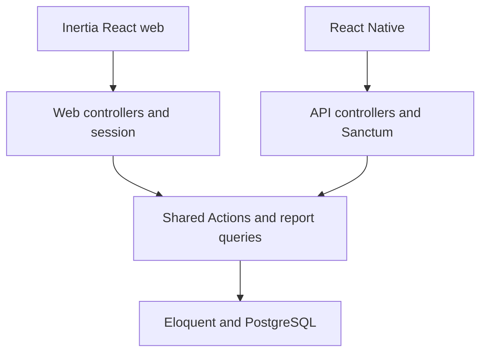

# ARCHITECTURE.md — BarberLog

Status: proposed implementation architecture, aligned with PRD v1.1. This document does not claim a repository or deployed application already implements it.

## 1. Product boundary

One shop, one owner account, no cashier. Record paid services, expenses, and reports. Web and Android share one backend/database. Four primary screens: Beranda, Riwayat, Laporan, Pengaturan. See `PRD.md` for detailed scope and acceptance criteria; see `AGENTS.md` for coding, evidence, naming, and Indonesian UI rules.

## 2. Baseline stack

| Layer                 | Project decision                                                        |
| --------------------- | ----------------------------------------------------------------------- |
| Backend               | Laravel 13, PHP 8.5 stable patch selected at installation               |
| Web                   | Inertia + React + TypeScript, Tailwind + shadcn/ui                      |
| Mobile                | React Native + TypeScript + Expo, Android first                         |
| Database              | PostgreSQL (pin a supported stable version at implementation), Eloquent |
| Web authentication    | Laravel session, secure cookies, CSRF                                   |
| Mobile authentication | Sanctum personal access token, SecureStore                              |
| Mobile server state   | TanStack Query                                                          |
| Hosting               | Docker, Nginx, PHP-FPM, PostgreSQL; Dokploy optional                    |

These choices come from the PRD. Inspect installed versions and lockfiles before implementation. Verify framework APIs against the installed version. Do not silently switch the database, auth mechanism, framework major, or Expo compatibility set.

## 3. Request boundaries



Web controllers return Inertia pages/redirects and validation errors. API controllers return JSON resources with HTTP status codes. Domain Actions must not return Inertia responses or depend on mobile UI. Common Actions enforce financial invariants for both transports.

The mobile app is native React Native, not a wrapper around the Inertia website. Share API contracts and selected pure formatting/types only where useful; keep DOM and native UI components separate.

## 4. Proposed directory ownership

Use this structure for a new repository. For an existing repository, map these responsibilities to its current layout; do not move all files merely to match this proposal.

| Path                                   | Responsibility                                               |
| -------------------------------------- | ------------------------------------------------------------ |
| `AGENTS.md`                            | Repository-wide AI working rules                             |
| `ARCHITECTURE.md`                      | Technical boundaries and decisions                           |
| `PRD.md`                               | Product requirements                                         |
| `backend/app/Actions/Transactions/`    | Create, update, delete transaction use cases                 |
| `backend/app/Actions/Expenses/`        | Expense use cases                                            |
| `backend/app/Queries/Reports/`         | Shared report and summary queries                            |
| `backend/app/Http/Controllers/Web/`    | Inertia transport                                            |
| `backend/app/Http/Controllers/Api/V1/` | Mobile JSON transport                                        |
| `backend/app/Http/Requests/`           | Validation and request authorization                         |
| `backend/app/Http/Resources/`          | Explicit JSON serialization                                  |
| `backend/app/Models/`                  | Eloquent entities and relations                              |
| `backend/app/Enums/`                   | Stable internal enum values                                  |
| `backend/database/migrations/`         | Schema evolution                                             |
| `backend/lang/id/`                     | Indonesian server-side messages                              |
| `backend/resources/js/pages/`          | Inertia screens                                              |
| `backend/resources/js/components/`     | Reusable web components                                      |
| `backend/resources/js/lib/`            | Focused web utilities                                        |
| `backend/resources/js/locales/id.ts`   | Indonesian app messages if no localization convention exists |
| `backend/tests/Feature/`               | HTTP, persistence, auth and invariant tests                  |
| `mobile/app/`                          | Expo Router routes, preserving required filenames            |
| `mobile/src/features/`                 | Native feature screens/hooks                                 |
| `mobile/src/components/`               | Native reusable components                                   |
| `mobile/src/lib/`                      | API client, formatting, token adapter                        |
| `mobile/src/locales/id.ts`             | Indonesian native messages                                   |
| `mobile/assets/`                       | Brand assets and launcher source                             |
| `docs/openapi.yaml`                    | Implemented API contract                                     |

These paths are a design proposal, not proof that files exist. Create only directories needed by the current implementation.

## 5. Business module boundaries

### Services

Manage names, prices, activation, and optional default service. Disable referenced services rather than deleting historical data. If a default is disabled, clear that default or fall back to no selection; never silently select an invalid service.

### Transactions

One paid visit has one transaction and one or more items. Store service_id, service_name_snapshot, unit_price, quantity, and line_total on items. Save total_amount, payment_method, occurred_at, reference, created_by, and version on the transaction.

If an edit retains the same service, preserve its existing name snapshot and actual price unless the owner intentionally changes the price. If the owner replaces/adds a service, snapshot that selected service at edit time. Record the correction in audit history.

### Expenses

Store description, amount, optional category, method, occurred_at, reference, created_by, and version. Expense categories are lightweight; no inventory or accounting ledger subsystem is required.

### Reports

Use the same query logic for dashboard, API, and CSV totals. Filter active records by occurred_at. Count transactions separately from item quantity. Avoid joins that multiply transaction totals by the number of items. Aggregate items only for service breakdowns.

### Settings and authentication

Single shop settings record and owner account provisioned during installation; no public registration. Business authorization remains server-side. Do not add complex role packages for one role.

## 6. Persistence invariants

Required business tables: users, shop_settings, services, transactions, transaction_items, expenses, audit_logs, idempotency_requests. Add framework tables for sessions, password resets, and Sanctum as needed. Exact columns follow the PRD and implemented migrations.

- Money: BIGINT integer rupiah, maximum Rp999.999.999 per transaction/expense. Validate unit prices, integer quantities, multiplication, and accumulated total before persistence. Reject invalid or non-finite numeric input.
- Quantity: positive integer; unit price can be zero but total must be positive.
- Time: store UTC; display and report in Asia/Jakarta. Construct inclusive start and exclusive next-day end from the requested Jakarta calendar dates.
- Data changes: transaction, items, audit, and idempotency reservation/result commit atomically.
- Deletion: soft-delete transactions/expenses; reporting excludes them. Audit is not editable from the product UI.
- Historical integrity: master price/name changes never rewrite previous transactions.
- IDs/references: unique database constraints, not only application checks. Do not use “count + 1” as a concurrent reference generator.

## 7. Idempotency and concurrency

For create operations, both web and mobile generate a UUID once per logical submission. Mobile sends Idempotency-Key. Inertia may submit a hidden English field such as idempotency_key; its controller maps that value to the same Action input. Retrying an uncertain submission preserves the key and original payload.

Scope uniqueness by actor, operation, and key. Canonicalize the validated business payload before hashing; exclude transport-only fields such as CSRF tokens. Different payload with the same key returns a conflict.

Use a unique reservation plus database transaction and safe conflict handling; do not use an unprotected “check then insert.” Persist the created resource reference. A replay must not recreate a resource that was later edited/deleted. Return a consistent original result reference without resurrecting deleted data; clients can reload current state. Test replay after corrections as well as ordinary retries.

Versioned update/delete use an atomic conditional update or row lock and expected_version. Exactly one concurrent writer succeeds. Version conflict maps to HTTP 409 for mobile; web presents an Indonesian reload/conflict message rather than a generic server error.

Do not clear a pending key or change its payload after a timeout until the original outcome is resolved. A deliberate new transaction gets a new key.

## 8. API and UI contract

Prefix `/api/v1`; English paths and snake_case JSON fields. Document endpoints in OpenAPI only when implemented or clearly mark proposed endpoints as unimplemented. PRD endpoint coverage is the delivery target, not a statement of current availability.

Response conventions: data for resources; data/meta for lists; message/errors for validation, with optional stable English error code. Human-readable messages are Indonesian. Map 401, 403, 404, 409, 422, 429, and network failures explicitly. Do not replace all failures with an empty successful response.

Presentation mapping example:

```ts
const paymentMethodLabels = {
    cash: 'Tunai',
    qris: 'QRIS',
    transfer: 'Transfer',
} as const;
```

Client form properties may use camelCase, such as paymentMethod; the API adapter maps them to payment_method. Do not leak ambiguous mixed shapes across layers. Use a single formatter per platform for currency and dates, with consistent behavior tested on sample values.

Web form success follows server confirmation. Mobile invalidates related transaction, history, dashboard, and report queries after successful mutations. Refetch on relevant focus/refresh events. There is no realtime or background offline sync requirement.

## 9. Security and operational behavior

- Session cookies and CSRF for web; Sanctum Bearer token for native API. Never fix 419/401 errors by disabling protections.
- Store mobile tokens in SecureStore; handle expiry with login. The PRD initially chooses 30-day token validity, not an assumed Sanctum default.
- Logout revokes the current token server-side and clears local credentials. If offline revocation fails, do not claim the server token was revoked; clear local access and handle revocation according to an explicit retry/session policy.
- Reset password revokes old tokens/sessions. Protect recovery endpoints with rate limits and generic account-disclosure-safe messages.
- Never expose raw exceptions, credentials, or database details to the UI.
- No payment gateway: a user-selected QRIS method is a manual record, not proof from a financial provider.
- Keep Docker secrets outside version control. Back up the database daily to separate storage, retain at least 14 days, and verify restore.
- CSV uses Indonesian display headings and labels, numeric amounts, correct escaping, and spreadsheet formula-injection protection on user text. Never count one transaction multiple times when it has multiple items.

## 10. Verification gates

Backend: tests for auth, validation, totals, historical snapshots, soft delete, audit atomicity, Jakarta date boundaries, idempotency under concurrency, version conflicts, and CSV consistency. Exercise concurrency/database-specific behavior on PostgreSQL; SQLite-only results do not establish PostgreSQL concurrency correctness.

Web/mobile: verify Indonesian copy, actual button behavior, form retention after errors, no false save success, state refresh, login expiry, and responsive/native layouts. Test the ordinary rapid entry flow without optional fields.

Use actual scripts from composer/package manifests. Separate static checks, unit/feature tests, browser inspection, emulator checks, and physical-device verification in reports. Passing one does not imply the others ran.

## 11. Change control

If a task needs a new domain module, offline writes, additional roles, another database, or payment integration, document the requested scope change before modifying this architecture. For a meaningful decision, add a short English-named document in `docs/decisions/` describing context, decision, alternatives, and consequences. Do not create decision paperwork for routine implementation choices.

Keep docs synchronized with behavior. Mark unimplemented items honestly. Architecture should guide maintainable implementation rather than generate unused layers.
