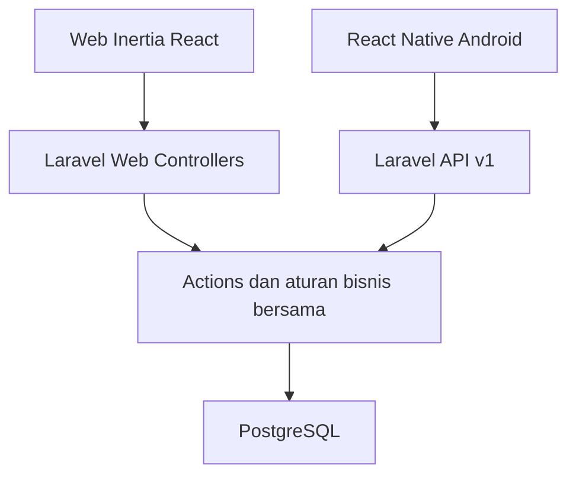

# PRD — Aplikasi Pencatatan Barbershop Sederhana

Versi: 1.1  
Tanggal: 30 Oktober 2026  
Status: Rancangan siap menjadi acuan implementasi  
Platform: Web dan mobile Android  
Bahasa: Indonesia | Mata uang: IDR | Zona waktu: Asia/Jakarta

## 1. Ringkasan produk

Aplikasi membantu pemilik barbershop mencatat pemasukan setelah pelanggan selesai dicukur, mencatat pengeluaran, dan melihat rekap harian/bulanan. Pemilik merangkap barber dan menggunakan aplikasi sendiri, tanpa kasir khusus.

Alur utama: **Selesai mencukur → Terima pembayaran → Pilih layanan → Simpan transaksi.**

Web dibangun menggunakan Laravel + Inertia React. Mobile menggunakan React Native dan mengakses API Laravel yang sama. Seluruh data tersimpan di satu database server agar dapat dilihat dari kedua platform.

## 2. Tujuan dan ukuran keberhasilan

- Menggantikan pencatatan buku atau catatan terpisah.
- Membuat pencatatan transaksi standar dapat dilakukan dalam maksimal 15 detik setelah login, dibuktikan melalui uji penggunaan.
- Menampilkan pemasukan, pengeluaran, dan selisih periode tanpa perhitungan manual.
- Menjaga hasil laporan web dan mobile konsisten untuk filter yang sama.
- Tidak membuat transaksi ganda akibat ketukan berulang atau retry jaringan dengan identitas permintaan yang sama.

Ukuran keberhasilan MVP: pemilik dapat mencatat aktivitas usaha selama tujuh hari, melakukan koreksi, dan mencocokkan laporan aplikasi dengan catatan pembanding tanpa selisih.

## 3. Asumsi dan batasan

1. Satu usaha, satu cabang, satu akun pemilik. Bukan SaaS multi-tenant.
2. Tidak ada akun kasir, pembagian peran, atau akun barber tambahan pada MVP.
3. Satu transaksi mewakili satu kunjungan yang sudah dibayar, dengan satu atau beberapa layanan. Jumlah transaksi bukan jumlah pelanggan unik.
4. Tidak mengumpulkan nama atau nomor telepon pelanggan.
5. Pembayaran diterima di luar aplikasi. Tunai, QRIS, dan transfer hanya dicatat secara manual; aplikasi tidak memproses pembayaran.
6. Semua nominal menggunakan rupiah bulat tanpa pecahan.
7. MVP memerlukan internet untuk menyimpan perubahan. Sinkronisasi offline tidak termasuk.
8. Android menjadi target rilis mobile pertama; iOS dapat dikembangkan dari basis React Native yang sama, tetapi validasi dan distribusinya merupakan tahap lanjutan.
9. PostgreSQL ditetapkan sebagai database sesuai pilihan pemilik. Gunakan database yang sama untuk development, pengujian integrasi, dan production.

## 4. Cakupan

### 4.1 Wajib dalam MVP

- Login, logout, ubah kata sandi, dan pemulihan akses.
- Pengaturan nama usaha dan layanan beserta harga.
- Pencatatan pemasukan dan pengeluaran.
- Riwayat, filter tanggal, detail, edit, dan hapus pencatatan dengan konfirmasi.
- Ringkasan hari ini serta laporan periode harian/bulanan/custom.
- Rincian pemasukan berdasarkan metode pembayaran dan layanan.
- Ekspor CSV dari laporan.
- Fitur inti yang sama pada web dan Android.
- Backup database, perlindungan akses, serta riwayat koreksi internal.

### 4.2 Di luar MVP

Antrean digital, booking, status pelayanan bertahap, shift dan tutup kas, uang kembalian, komisi, payroll, data pelanggan, membership, stok produk, penjualan barang, struk printer, payment gateway, split payment, piutang, diskon terpisah, refund pembayaran nyata, multi-cabang, dan subscription.

Koreksi/hapus pencatatan hanya memperbaiki catatan. Tindakan tersebut tidak mengembalikan uang ke pelanggan. Kebutuhan refund nyata perlu modul tersendiri pada pengembangan berikutnya.

## 5. Pengguna dan skenario

| Pengguna                 | Kebutuhan                                                           | Hak akses                    |
| ------------------------ | ------------------------------------------------------------------- | ---------------------------- |
| Pemilik yang juga barber | Mencatat pemasukan/pengeluaran dengan cepat dan melihat hasil usaha | Semua fitur untuk satu usaha |

Skenario utama:

- Setelah menerima Rp25.000 untuk potong rambut, pemilik membuka aplikasi, memilih layanan dan metode pembayaran, kemudian menyimpan.
- Saat membeli silet Rp15.000, pemilik mencatat pengeluaran dengan keterangan singkat.
- Pada malam hari, pemilik melihat pemasukan tunai/QRIS/transfer dan pengeluaran hari itu.
- Jika salah memasukkan harga, pemilik memperbaiki catatan dan laporan langsung mengikuti perubahan.

## 6. Alur pengguna

### 6.1 Persiapan awal

1. Akun pemilik dibuat melalui proses instalasi/command admin; tidak ada registrasi publik.
2. Pemilik login dan mengganti kata sandi awal.
3. Isi nama usaha dan tambahkan minimal satu layanan.
4. Pilih layanan default jika diinginkan.
5. Mulai mencatat transaksi.

### 6.2 Tambah transaksi

1. Tekan **Tambah Transaksi** pada Beranda.
2. Layanan default otomatis terpilih; jika tidak ada default, pilih layanan.
3. Harga otomatis mengikuti master layanan. Pemilik dapat mengubah harga aktual atau menambah layanan lain.
4. Metode pembayaran default Tunai; tersedia QRIS dan Transfer.
5. Tanggal/jam otomatis sekarang, dapat diganti untuk catatan lampau.
6. Catatan opsional.
7. Tekan **Simpan**; tombol menampilkan proses dan tidak dapat ditekan ulang.
8. Setelah server mengonfirmasi berhasil, tampilkan pesan sukses dan perbarui ringkasan.

Tidak ada langkah memasukkan pelanggan, nomor antrean, atau memilih barber.

### 6.3 Tambah pengeluaran

Tekan **Tambah Pengeluaran** → isi keterangan dan nominal → pilih metode pembayaran (default Tunai) → cek tanggal → Simpan. Kategori ringan opsional: Perlengkapan, Listrik/Air, Sewa, Lainnya.

### 6.4 Koreksi catatan

Riwayat → Detail → Edit → ubah data → Simpan. Server menyimpan nilai sebelum/sesudah untuk audit internal. Untuk hapus, tampilkan konfirmasi dengan tanggal dan nominal; catatan diberi soft delete dan dikeluarkan dari laporan aktif.

### 6.5 Melihat laporan

Pilih Hari ini, Bulan ini, atau rentang tanggal → lihat total dan rincian → ekspor CSV bila diperlukan. Laporan tidak memerlukan proses tutup hari.

### 6.6 Koneksi gagal

- Jika gagal sebelum pengiriman, pertahankan formulir dan tampilkan **Belum tersimpan**.
- Jika respons timeout dan status penyimpanan belum diketahui, retry menggunakan idempotency key yang sama.
- Jangan tampilkan sukses sebelum ada konfirmasi server.
- Tidak ada antrean sinkronisasi otomatis. Formulir dipertahankan selama layar tetap terbuka; kehilangan draft setelah aplikasi ditutup paksa merupakan batas MVP.

## 7. Kebutuhan fungsional

| ID    | Kebutuhan            | Kriteria penerimaan                                                                                                                       |
| ----- | -------------------- | ----------------------------------------------------------------------------------------------------------------------------------------- |
| FR-01 | Autentikasi          | Pengguna tanpa login tidak dapat membaca atau mengubah data; logout mobile mencabut token perangkat aktif                                 |
| FR-02 | Kelola layanan       | Tambah/edit nama dan harga, nonaktifkan layanan; layanan nonaktif tidak bisa dipilih untuk transaksi baru                                 |
| FR-03 | Tambah pemasukan     | Minimal satu layanan, kuantitas integer positif default 1, harga integer minimal 0, total transaksi lebih dari 0; server menghitung total |
| FR-04 | Tambah pengeluaran   | Keterangan wajib, nominal integer lebih dari 0, tanggal dan metode pembayaran valid                                                       |
| FR-05 | Riwayat              | Menampilkan pemasukan/pengeluaran terbaru, paginasi, filter jenis dan tanggal, akses detail                                               |
| FR-06 | Koreksi              | Edit memperbarui laporan; hapus memerlukan konfirmasi dan tidak menghilangkan jejak internal                                              |
| FR-07 | Ringkasan            | Menampilkan pemasukan, jumlah transaksi, pengeluaran, dan selisih hari ini dalam WIB                                                      |
| FR-08 | Laporan              | Total sesuai catatan aktif pada periode; rincian metode pembayaran serta layanan konsisten dengan total                                   |
| FR-09 | Ekspor               | CSV UTF-8 sesuai filter, berisi tanggal, jenis, nomor referensi, keterangan, metode, pemasukan dan pengeluaran                            |
| FR-10 | Pengaturan           | Nama usaha, layanan default, ubah kata sandi; zona waktu MVP tetap Asia/Jakarta                                                           |
| FR-11 | Konsistensi platform | Data yang dibuat di web tersedia setelah refresh di mobile, dan sebaliknya                                                                |
| FR-12 | Pencegahan duplikasi | Retry create dengan key dan payload sama menghasilkan record yang sama, bukan tambahan baru                                               |

## 8. Menu dan kebutuhan tampilan

Empat menu utama: **Beranda, Riwayat, Laporan, Pengaturan**. Mobile memakai bottom navigation, web memakai sidebar dengan navigasi ringkas pada layar kecil.

### Beranda

- Tanggal hari ini.
- Kartu total pemasukan, jumlah transaksi, pengeluaran, dan selisih.
- Tombol utama Tambah Transaksi; tombol sekunder Tambah Pengeluaran.
- Lima catatan terbaru.

### Form transaksi

Pilihan layanan, harga, kuantitas default 1, tambah layanan opsional, metode pembayaran, tanggal/jam, catatan opsional, total, Simpan. Form default harus ringkas; tanggal dan catatan dapat berada pada bagian rincian opsional.

### Riwayat

Filter periode dan jenis; daftar waktu, ringkasan layanan/keterangan, nominal dan metode; detail dengan Edit dan Hapus. Tampilkan empty state yang mengarahkan ke pencatatan pertama.

### Laporan

Total periode, rincian pemasukan per metode, layanan terlaris berdasarkan jumlah layanan, pengeluaran, serta ekspor CSV. Grafik tidak wajib pada MVP.

### Prinsip UX

Bahasa Indonesia, nominal format Rp25.000, keyboard angka pada nominal mobile, target sentuh minimal 44 px pada web atau ukuran logis setara pada mobile, pesan validasi di dekat kolom, konfirmasi sebelum meninggalkan formulir yang berubah, serta loading/error/empty state yang jelas.

## 9. Aturan bisnis dan perhitungan

- Total transaksi = jumlah seluruh (harga aktual per layanan × kuantitas).
- Pemasukan periode = total transaksi aktif berdasarkan waktu transaksi, bukan created_at.
- Pengeluaran periode = total pengeluaran aktif berdasarkan waktu pengeluaran.
- Selisih = pemasukan − pengeluaran. Label UI **Selisih**, bukan laba bersih atau saldo kas.
- Jumlah transaksi = jumlah record transaksi aktif, bukan jumlah item layanan atau pelanggan unik.
- Rincian per metode pembayaran berasal dari metode yang tercatat pada transaksi.
- Harga dan nama layanan disalin ke item saat transaksi. Perubahan master tidak mengubah riwayat.
- Penyesuaian harga adalah harga aktual yang disepakati; tidak ada perhitungan diskon terpisah.
- Tanggal lampau diperbolehkan, tanggal masa depan ditolak.
- Periode laporan menggunakan batas awal inklusif dan awal hari setelah tanggal akhir eksklusif dalam Asia/Jakarta, lalu dikonversi ke UTC untuk query.
- Seluruh perubahan transaksi dan item serta audit ditulis dalam database transaction.
- Koreksi menggunakan version integer untuk mencegah perubahan perangkat lain tertimpa diam-diam; konflik mengembalikan 409 dan meminta muat ulang.
- CSV menghitung satu baris per transaksi/pengeluaran, bukan menduplikasi total transaksi untuk setiap layanan. Escape teks yang dapat dianggap formula spreadsheet.

Contoh penerimaan: 10 transaksi masing-masing Rp25.000 dan pengeluaran Rp30.000 menghasilkan pemasukan Rp250.000, jumlah transaksi 10, serta selisih Rp220.000.

## 10. Stack dan keputusan versi

| Lapisan                  | Pilihan                                                                                   |
| ------------------------ | ----------------------------------------------------------------------------------------- |
| Backend                  | Laravel 13.x                                                                              |
| Runtime                  | PHP 8.5, patch stabil terbaru; hasil pengecekan 30 Oktober 2026: PHP 8.5.12               |
| Web                      | Inertia.js + React + TypeScript, mengikuti kombinasi kompatibel starter kit resmi Laravel |
| UI web                   | Tailwind CSS + shadcn/ui                                                                  |
| Mobile                   | React Native + TypeScript, Expo sebagai pilihan implementasi                              |
| Navigasi mobile          | Expo Router                                                                               |
| Data mobile              | TanStack Query dan HTTP client fetch/axios                                                |
| Penyimpanan token mobile | Expo SecureStore                                                                          |
| Database                 | PostgreSQL; versi stabil yang didukung dipilih dan dikunci saat implementasi              |
| ORM                      | Eloquent                                                                                  |
| Autentikasi web          | Session cookie Laravel dengan proteksi CSRF                                               |
| Autentikasi mobile       | Laravel Sanctum personal access token                                                     |
| Pengujian                | PHPUnit/Pest; React Native Testing Library; smoke test perangkat Android                  |
| Deployment               | Docker, Nginx, PHP-FPM, PostgreSQL; dapat dikelola melalui Dokploy                        |

Laravel 13 mendukung PHP 8.3–8.5 menurut dokumentasi resminya. Jangan memakai versi beta/RC untuk production. Pin patch runtime yang dipakai dalam konfigurasi build dan commit lockfile. Saat implementasi, pilih Expo SDK stabil lalu ikuti versi React Native/React yang didukung SDK tersebut; jangan memaksa versi terbaru masing-masing secara terpisah. React web dan React Native tidak harus memakai versi React yang sama.

Versi dependency selain PHP/Laravel di atas merupakan keputusan implementasi yang harus divalidasi kompatibilitasnya saat instalasi, bukan klaim versi terbaru.

## 11. Arsitektur



- Web Inertia menggunakan route/controller Laravel dan session. Web tidak wajib memanggil REST API untuk setiap halaman.
- Mobile mengakses JSON REST API, bukan response Inertia atau WebView.
- Kedua controller menggunakan action/service yang sama untuk create, edit, delete, dan laporan.
- Validasi dan otorisasi tetap dilakukan server-side; validasi client hanya membantu UX.
- Database server menjadi sumber data utama. Invalidate cache mobile setelah mutasi, refresh saat layar kembali aktif, dan sediakan pull-to-refresh. Web mengambil ulang props saat navigasi atau refresh. Tidak perlu WebSocket pada MVP.
- Infrastruktur cukup satu aplikasi monolit. Redis, microservices, dan event bus belum diperlukan.

Struktur kode usulan: Laravel berada di `backend/`, termasuk React web di `backend/resources/js/`; aplikasi Expo berada di `mobile/`; kontrak API berada di `docs/openapi.yaml`. Gunakan Actions untuk transaksi/pengeluaran dan query/service laporan bersama. UI web dan mobile terpisah; tipe kontrak API dapat dibagikan, tetapi komponen DOM tidak digunakan langsung pada mobile.

## 12. Skema database minimum

Semua tabel bisnis memakai primary key bigint, timestamps UTC, dan foreign key sesuai relasi. Nominal disimpan BIGINT rupiah, bukan float. API membatasi nominal dan total maksimal Rp999.999.999 per catatan agar aman untuk UI JavaScript.

| Tabel                            | Kolom utama                                                                                                                                               |
| -------------------------------- | --------------------------------------------------------------------------------------------------------------------------------------------------------- |
| users                            | id, name, email unique, password, timestamps                                                                                                              |
| shop_settings                    | id singleton, name, timezone, currency, default_service_id nullable                                                                                       |
| services                         | id, name, price, is_active, timestamps                                                                                                                    |
| transactions                     | id, reference unique, occurred_at, payment_method, total_amount, note nullable, created_by, version default 1, deleted_at nullable, timestamps            |
| transaction_items                | id, transaction_id, service_id, service_name_snapshot, unit_price, quantity, line_total, timestamps                                                       |
| expenses                         | id, reference unique, occurred_at, description, category nullable, amount, payment_method, created_by, version default 1, deleted_at nullable, timestamps |
| audit_logs                       | id, user_id, entity_type, entity_id, action, before_json nullable, after_json nullable, created_at                                                        |
| idempotency_requests             | id, user_id, operation, key, request_hash, resource_type, resource_id, created_at                                                                         |
| personal_access_tokens           | Struktur bawaan Sanctum untuk token perangkat                                                                                                             |
| sessions / password_reset_tokens | Struktur pendukung autentikasi Laravel                                                                                                                    |

Relasi: transaksi memiliki banyak item; item menunjuk master layanan dan menyimpan snapshot. services dinonaktifkan, bukan dihapus permanen jika sudah digunakan. Audit tidak dapat diedit melalui UI.

Index minimum: transactions(occurred_at, deleted_at), expenses(occurred_at, deleted_at), transaction_items(transaction_id), unique idempotency_requests(user_id, operation, key). Tambahkan foreign key created_by ke users. Kolom payment_method dibatasi ke cash, qris, transfer lewat validasi serta constraint yang sesuai.

Tidak perlu tabel pelanggan, barber, booking, shift, atau komisi pada MVP.

## 13. Kontrak API mobile

Prefix: `/api/v1`. Selain login dan pemulihan sandi, semua endpoint membutuhkan Bearer token Sanctum.

| Method         | Endpoint              | Fungsi                                               |
| -------------- | --------------------- | ---------------------------------------------------- |
| POST           | /auth/login           | Email, password, device_name; mengembalikan token    |
| POST           | /auth/logout          | Mencabut token saat ini                              |
| GET            | /auth/me              | Informasi pemilik                                    |
| POST           | /auth/forgot-password | Kirim tautan pemulihan; respons generik              |
| PUT            | /auth/password        | Ubah sandi dengan current_password; cabut token lain |
| GET            | /dashboard            | Ringkasan hari ini                                   |
| GET/POST       | /services             | Daftar dan tambah layanan                            |
| PUT            | /services/{id}        | Edit harga/nama atau status aktif                    |
| GET/POST       | /transactions         | Daftar dan tambah pemasukan                          |
| GET/PUT/DELETE | /transactions/{id}    | Detail, edit, soft delete                            |
| GET/POST       | /expenses             | Daftar dan tambah pengeluaran                        |
| GET/PUT/DELETE | /expenses/{id}        | Detail, edit, soft delete                            |
| GET            | /history              | Daftar gabungan pemasukan/pengeluaran                |
| GET            | /reports/summary      | Total dan rincian periode                            |
| GET            | /reports/export       | CSV sesuai periode dan jenis                         |
| GET/PUT        | /settings             | Baca/ubah pengaturan usaha                           |

Pemulihan sandi membuka halaman reset web Laravel dari tautan email, sehingga tidak memerlukan form reset native. SMTP harus disiapkan; command reset admin tersedia sebagai prosedur pemulihan instalasi.

Parameter daftar/laporan: date_from, date_to dalam YYYY-MM-DD, type bila relevan, page, per_page maksimal 100. API response daftar memakai data dan meta; error validasi memakai message dan errors. Waktu API memakai ISO 8601 dengan offset/UTC.

Contoh payload create transaksi:

```json
{
    "occurred_at": "2026-10-30T09:00:00+07:00",
    "payment_method": "cash",
    "items": [{ "service_id": 1, "quantity": 1, "unit_price": 25000 }],
    "note": null
}
```

Client mengirim header `Idempotency-Key` berupa UUID untuk create transaksi/pengeluaran. Server menyimpan key, hash payload, dan referensi hasil secara atomik bersama catatan. Key yang sama dan payload sama mengembalikan hasil yang sama; payload berbeda menghasilkan 409. Constraint unique dan penanganan konflik wajib mencegah race pada dua request serentak. Simpan key selama catatan dipertahankan pada MVP, termasuk setelah soft delete.

HTTP: 201 untuk create baru, 200 untuk baca/edit/replay, 204 untuk delete/logout, 401 untuk sesi tidak sah, 403 untuk akses ditolak, 404 untuk data tidak ditemukan, 409 untuk konflik versi/key, 422 untuk validasi, 429 untuk pembatasan request. Delete berulang boleh mengembalikan 204 tanpa membuat audit ganda. Update/delete menyertakan expected_version; server mengunci/menguji versi sebelum mutasi.

## 14. Keamanan dan kebutuhan nonfungsional

- HTTPS wajib; secret hanya di environment server, tidak di aplikasi mobile atau repositori.
- Password di-hash menggunakan fasilitas Laravel. Terapkan rate limit login dan pemulihan sandi.
- Web menggunakan cookie HttpOnly, Secure, SameSite yang sesuai dan CSRF. Jangan menyimpan token web di localStorage.
- Mobile menyimpan token di SecureStore; token berlaku 30 hari sebagai keputusan produk awal. Saat kedaluwarsa, minta login ulang. Logout menghapus token lokal dan mencabut token server.
- Reset sandi mencabut seluruh token mobile dan sesi web lama; ubah sandi meminta sandi saat ini dan mengakhiri sesi perangkat lain.
- Jangan mencatat password/token ke log. Endpoint bisnis selalu dilindungi autentikasi, walau hanya satu akun.
- Target respons p95 endpoint pencatatan/laporan kurang dari 1 detik pada dataset 10.000 transaksi di lingkungan uji yang disepakati; latensi jaringan pengguna diukur terpisah.
- Backup database harian, retensi minimum 14 hari, salinan di luar server aplikasi. Target kehilangan data maksimum 24 jam dan pemulihan maksimum 4 jam setelah backup tersedia.
- Uji restore sebelum rilis dan berkala. CSV bukan pengganti backup database.
- Web mendukung tampilan mulai lebar 360 px. Build Android harus diuji pada minimal satu perangkat fisik sesuai minimum OS Expo SDK yang dipilih.
- Kegagalan server harus mengembalikan pesan ramah tanpa detail kredensial atau stack trace.

## 15. Pengujian dan penerimaan rilis

| Skenario                              | Hasil wajib                                                     |
| ------------------------------------- | --------------------------------------------------------------- |
| Tambah 1 layanan Rp25.000             | Satu transaksi, total Rp25.000                                  |
| Dua layanan Rp25.000 dan Rp10.000     | Satu transaksi dengan dua item, total Rp35.000                  |
| Harga layanan master berubah          | Transaksi lama tetap memakai snapshot lama                      |
| Double tap dan retry timeout          | Satu record untuk idempotency key yang sama                     |
| Dua perangkat edit bersamaan          | Perubahan kedua dengan versi lama ditolak 409                   |
| Edit/hapus transaksi atau pengeluaran | Dashboard, laporan dan CSV konsisten; audit tersedia            |
| Transaksi pukul 00.05 WIB             | Masuk hari lokal yang benar walau tanggal UTC berbeda           |
| Filter akhir bulan                    | Tidak kehilangan atau menggandakan data pada batas periode      |
| Data dibuat web lalu refresh mobile   | Nilai dan rincian identik                                       |
| Akses tanpa token/session             | Ditolak tanpa membocorkan data                                  |
| Offline/timeout                       | Tidak ada notifikasi sukses palsu; form tetap bisa dicoba ulang |
| Restore backup                        | Aplikasi dan data bisnis kembali bisa digunakan                 |

Rilis diterima setelah seluruh skenario kritis lulus, build web/mobile berhasil, migrasi pada database kosong berhasil, ekspor dapat dibuka, dan uji penggunaan menunjukkan alur pencatatan memenuhi target 15 detik.

## 16. Roadmap implementasi

Estimasi awal 4–6 minggu untuk satu pengembang yang sudah memahami stack; bukan komitmen durasi. Estimasi mencakup web dan Android, belum termasuk proses publikasi app store.

| Tahap              | Perkiraan                 | Hasil                                                               |
| ------------------ | ------------------------- | ------------------------------------------------------------------- |
| 1. Fondasi         | Minggu 1                  | Setup Laravel/PHP, database, auth, pengaturan, layanan, kontrak API |
| 2. Operasional web | Minggu 2                  | Transaksi, pengeluaran, riwayat, audit, idempotensi                 |
| 3. Laporan dan API | Minggu 3                  | Ringkasan, laporan, CSV, API mobile dan pengujian aturan bisnis     |
| 4. Mobile          | Minggu 4–5                | Login, empat menu, formulir, error/retry, ekspor dan berbagi file   |
| 5. Rilis           | Minggu 6 atau lebih cepat | Uji perangkat, backup/restore, deployment dan uji penggunaan        |

Prioritas ketika waktu terbatas: selesaikan web dan API dahulu; kemudian mobile memakai aturan bisnis yang sudah diuji. Ini merupakan urutan implementasi, bukan penghapusan mobile dari cakupan.

## 17. Checklist selesai

- [ ] Web Laravel + Inertia React dapat digunakan pemilik.
- [ ] Aplikasi Android React Native mengakses backend yang sama.
- [ ] Empat menu utama selesai tanpa menambah alur kasir/antrean.
- [ ] Transaksi dan pengeluaran mendukung koreksi aman.
- [ ] Laporan serta CSV cocok dengan data uji.
- [ ] Pencegahan duplikasi dan konflik edit lulus uji.
- [ ] HTTPS, backup, pemulihan akses, dan restore telah diverifikasi.
- [ ] Dokumentasi instalasi, environment, deployment, serta penggunaan tersedia.

## 18. Referensi teknis

Diperiksa pada 30 Oktober 2026. Referensi untuk pilihan teknologi, bukan sumber persyaratan bisnis yang merupakan rancangan dokumen ini.

- PHP Downloads: https://www.php.net/downloads.php — versi stabil PHP.
- Laravel Release Notes: https://laravel.com/framework/docs/releases — versi Laravel dan kompatibilitas PHP.
- Laravel React Starter Kit: https://laravel.com/docs/13.x/starter-kits — integrasi React/Inertia.
- Laravel Sanctum: https://laravel.com/docs/13.x/sanctum — autentikasi API/mobile.
- Expo SDK Reference: https://docs.expo.dev/versions/latest/ — baseline paket mobile yang kompatibel.
